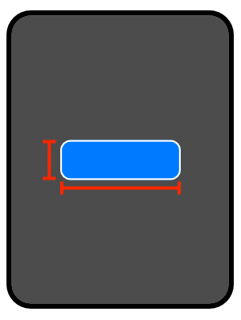
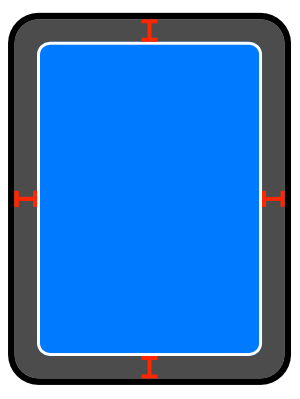
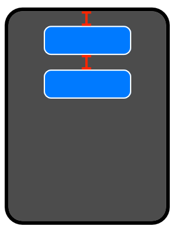

# Hamcrest AutoLayout Matchers

This frameworks contains [Hamcrest](https://github.com/nschum/SwiftHamcrest) matchers to verify auto layout constraints.

Example:

```
func test_height_matcher() {
	// given
	first.heightAnchor.constraint(equalToConstant: 44.0).isActive = true
		
	// expect
	assertThat(first, hasHeight(of: 44))
}
``` 

## Center and Size



```swift
assertThat(view, isVerticalCenter())
assertThat(view, isHorizontalCenter())
// or
assertThat(view, isCenter())

assertThat(view, hasWidth(of:150))
assertThat(view, hasHeight(of:44))


```

## Pinned




```swift
assertThat(view, isPinned(.top, gap: 20))
assertThat(view, isPinned(.left, gap: 20))
assertThat(view, isPinned(.right, gap: 20))
assertThat(view, isPinned(.bottom, gap: 20))
// or
assertThat(view, isPinned(.leading, gap: 20))
assertThat(view, isPinned(.trailing, gap: 20))

// isPinned(<NSLayoutConstraint.Attribute>)
```

## Pinned to other



```swift
assertThat(first, isPinned(.top, gap: 20))
assertThat(first, isVerticalCenter())
//assertThat(first, hasWidth(of:150))
//assertThat(first, hasHeight(of:44))

assertThat(second, hasSameWidthAs(first))
assertThat(second, hasSameHeightAs(first))
assertThat(second, isVerticalCenter())
assertThat(second, isPinned(.top, toView: first, gap: 20))

```

### Save Area

```swift
// Safe area
assertThat(view, isPinnedToSafeAreaAnchor(.top))

// Readable Anchor
assertThat(view, isPinnedToReadableAnchor(.leading))
```

# List of all Matchers

## 📏 Size

| Matcher | Verifies |
| --- | --- |
| `hasWidth(of: 150)` | width constraint with constant 150 |
| `hasHeight(of: 44)` | height constraint with constant 44 |
| `hasWidth(of: 150, withPriority: .defaultHigh)` | width with a specific priority |
| `hasHeight(of: 44, withPriority: .defaultHigh)` | height with a specific priority |
| `hasMinWidth(of: 100)` | width ≥ 100 (`greaterThanOrEqual`) |
| `hasMinHeight(of: 44)` | height ≥ 44 |
| `hasWidth(greaterThan(100))` | width matched against any `Matcher<CGFloat>` / `Matcher<Double>` |
| `hasHeight(lessThan(200))` | height matched against any Hamcrest matcher |
| `hasConstraint(.width)` | any active constraint with the given attribute |
| `hasConstantConstraint(.height, constant: 44, relation: .equal, withPriority: .required)` | generic constant-constraint matcher |

## 🎯 Center

| Matcher | Verifies |
| --- | --- |
| `isCenterX()` | centerX equal to superview's centerX |
| `isCenterX(offset: 10)` | centerX with constant offset |
| `isCenterX(with: otherView, offset: 0)` | centerX equal to another view |
| `isCenterY()` | centerY equal to superview's centerY |
| `isCenterY(offset: 10)` | centerY with constant offset |
| `isCenterY(with: otherView, offset: 0)` | centerY equal to another view |
| `isCenter()` | both `isCenterX()` and `isCenterY()` |
| `isCenter(with: otherView)` | centered on another view |
| `isEqualCenterX()` / `isEqualCenterY()` | aliases of `isCenterX()` / `isCenterY()` |
| `isEqualCenterX(offset:)` / `isEqualCenterY(offset:)` | with offset |
| `isEqualCenterX(with: otherView)` / `isEqualCenterY(with: otherView)` | equal center to another view |
| `isEqualCenter()` | both equal centers |
| `isCenterX(priority: .defaultHigh, offset: 0)` | with layout priority |

## 📌 Pinned (to superview)

| Matcher | Verifies |
| --- | --- |
| `isPinned(.top)` / `isPinned(.bottom)` | pinned with gap 0 to superview |
| `isPinned(.leading)` / `isPinned(.trailing)` | leading/trailing pinned |
| `isPinned(.left)` / `isPinned(.right)` | left/right pinned |
| `isPinned(.top, gap: 20)` | pinned with a gap |
| `isPinned(.top, gap: closeTo(20, 0.001))` | pinned, gap matched by any `Matcher<Float>` |
| `isPinned(.top, relatedBy: .lessThanOrEqual)` | pinned with a custom relation |
| `isPinned(.top, gap: 20, priority: .defaultHigh)` | with layout priority |
| `isPinnedToAllEdges(gap: 8)` | all four edges pinned |
| `isPinned(first: .top, second: .bottom, gap: equalTo(10))` | explicit first/second attribute pair |
| `isPinned(.top, to: layoutGuide, gap: 10)` | pinned to any `AnyObject` (e.g. `UILayoutGuide`) |
| `isPinned(.top, withGuide: topLayoutGuide, priority:)` | pinned to a `UILayoutSupport` (legacy) |

## 🔗 Pinned to another view

| Matcher | Verifies |
| --- | --- |
| `isPinned(.top, toView: otherView)` | attribute pinned to another view, gap 0 |
| `isPinned(.top, toView: otherView, gap: 20)` | with gap |
| `isPinned(.top, toView: otherView, gap: equalTo(20), priority: .required, relatedBy: .equal)` | full form with gap matcher |
| `hasEqualConstraint(.top, with: otherView)` | equal constraint to another view |
| `hasEqualConstraint(.top, constant: 10, priority: .required)` | equal constraint to superview |
| `hasSameWidthAs(otherView)` *(README alias)* | width equal to another view |
| `hasSameHeightAs(otherView)` *(README alias)* | height equal to another view |
| `hasSameWidth(otherView)` | width equal; also supports `multiplier:`, `priority:`, `constant:` |
| `hasSameHeight(otherView)` | height equal; also supports `multiplier:`, `priority:`, `constant:` |
| `hasSameSize()` | width == height of the view itself (square) |
| `hasSameWidthAndHeight()` | alias of `hasSameSize()` |

## 🧭 Guides (safe area, readable content, keyboard)

`Guide` enum: `.safeArea`, `.readable`, `.keyboard`, `.content`

| Matcher | Verifies |
| --- | --- |
| `isPinnedToSafeAreaAnchor(.top)` | attribute pinned to the safe area (gap 0) |
| `isPinnedToSafeAreaAnchor(.top, gap: 10)` | with gap |
| `isPinnedToReadableAnchor(.leading)` | pinned to the readable content guide |
| `isPinnedToReadableAnchor(.leading, gap: 10)` | with gap |
| `isPinned(.top, guide: .safeArea, gap: 10)` | pinned to any `Guide` |
| `isPinned(.top, guide: someUILayoutGuide, gap: 10)` | pinned to a concrete `UILayoutGuide` |
| `hasAnchor(.top, someUILayoutGuide)` | anchor pinned to a `UILayoutGuide`, gap 0 |
| `isPinned(.topSafeArea, gap: 10)` | `ExtraAttribute` shorthand: `.topSafeArea`, `.bottomSafeArea`, `.leadingSafeArea`, `.trailingSafeArea` |
| `isPinned(.leadingReadable, gap: 10)` | `.leadingReadable`, `.trailingReadable` shorthands |

## 🧱 Stacking & Aligning

| Matcher | Verifies |
| --- | --- |
| `isStacked(onTopOf: otherView)` | view's bottom == other view's top (gap 0) |
| `isStacked(onTopOf: otherView, gap: 8)` | with gap |
| `isAligned(with: otherView, to: .top)` | same attribute aligned with another view, gap 0 |
| `isAligned(with: otherView, to: .top, gap: 8)` | with gap |
| `isAligned(to: .top)` | attribute aligned with its superview |
| `isAligned(to: .leading, gap: 8)` | with gap |

